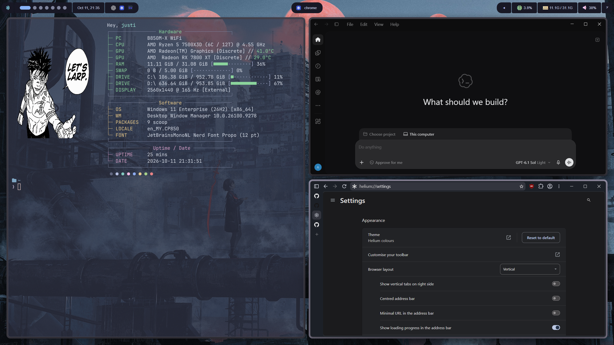

# Rice Windows Dotfiles

My Windows setup with YASB, Komorebi, WezTerm, Fastfetch, and Yazi.



- **YASB:** rounded bar, workspaces, taskbar, system tray, and widgets.
- **WezTerm:** Catppuccin Frappe, JetBrainsMono Nerd Font, and 70% background opacity.
- **Fastfetch:** custom artwork and colored system info on terminal startup.
- **PowerShell:** Oh My Posh prompt, Terminal-Icons, and `y` to open Yazi and keep its exit directory.
- **Komorebi:** seven workspaces, custom borders/gaps, and whkd hotkeys.

## Setup

Install PowerShell 7, Git, YASB, Komorebi, whkd, WezTerm, Fastfetch, Yazi, Oh My Posh, and JetBrainsMono Nerd Font. Add the command-line apps to PATH.

```powershell
Install-Module Terminal-Icons -Scope CurrentUser

git clone git@github.com:justinlengch/rice-windows-dotfiles.git
cd rice-windows-dotfiles
pwsh -NoProfile -File .\install.ps1
```

The installer backs up existing files and sets paths for your Windows user. Remove duplicate startup blocks from `$PROFILE` if needed, then restart WezTerm and YASB.

- Start tiling and hotkeys: `komorebic start --whkd`.
- Weather: copy `yasb/.env.example` to `~/.config/yasb/.env` and add your API key and city.
- Yazi uses defaults. Run `y`; set `YAZI_FILE_ONE` to your Git installation's `usr\bin\file.exe` if needed.
- Main hotkeys: Alt + H/J/K/L to focus, Alt + 1–7 for workspaces, Win + Alt + F for Yazi. Full bindings are in `whkd/whkdrc`.

## Credits

- **Fastfetch:** based on another creator's config, with my own changes. Creator/link to be added.
- **YASB:** believed to be based on the Aurora theme, with my own tweaks.
